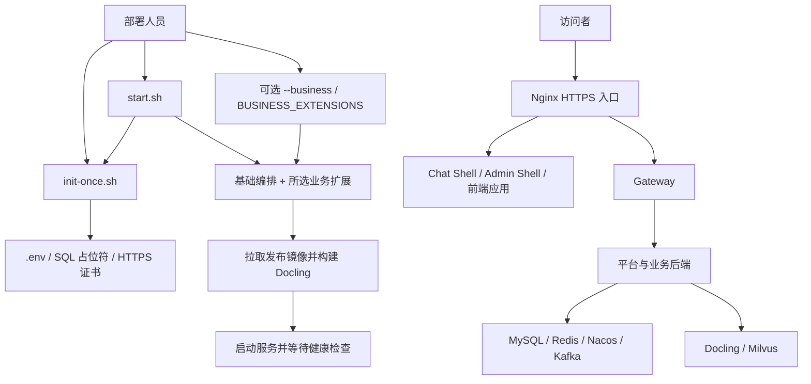

<p align="center">
  
</p>

# g2rain-bootstrap

[](LICENSE)
[](https://docs.docker.com/compose/)
[](https://www.gnu.org/software/bash/)

> 谷雨G2rain智能体平台，为企业提供智能体应用与平台基础能力。

g2rain-bootstrap 是平台的快速启动与部署入口，基于 Docker Compose 组装基础服务、智能体与知识库应用。G2rain 服务只拉取已经发布的 GHCR 镜像；第三方 Docling 以官方 GHCR 镜像为基础，在本地应用最小兼容修复。

[官网](http://www.g2rain.com) · [工程文档](docs/index.md) · [g2rain-deploy](https://github.com/g2rain/g2rain-deploy) · [中央文档](https://github.com/g2rain/g2rain)

## 目录

- [包含能力](#包含能力)
- [环境要求](#环境要求)
- [快速开始](#快速开始)
- [镜像策略](#镜像策略)
- [数据与安全](#数据与安全)
- [职责边界](#职责边界)
- [部署拓扑](#部署拓扑)
- [配置与扩展](#配置与扩展)
- [部署命令与检查](#部署命令与检查)
- [验证](#验证)
- [目录说明](#目录说明)
- [备份与回滚](#备份与回滚)
- [常见问题](#常见问题)
- [工程文档](#工程文档)
- [交流与贡献](#交流与贡献)

## 包含能力

- Agent 扩展：面向访客的 Chat Shell，以及 Agent 配置、运行、模型接入和 MCP 工具管理
- 企业知识库、文档解析与向量检索
- 基础栈：统一身份、网关、权限及始终启用的 Admin Shell 管理端
- 可选业务扩展：部门、会员、CMS（按需加载）
- MySQL、Redis、Nacos、Kafka、Milvus 和 Nginx 基础设施

基础编排包含 13 个服务。业务扩展全部由 `BUSINESS_EXTENSIONS` 或 `--business` 选择；`.env.example` 预填 Agent、Knowledge 时完整栈为 23 个服务。

## 环境要求

- Linux x86_64
- Docker Engine 24+
- Docker Compose 2.20+
- OpenSSL
- 最低单请求 Demo：4 核 CPU、16 GB 内存和 40 GB 可用磁盘；其中容器资源上限合计约 11.7 GB

若 GHCR 包需要认证，先执行：

```bash
echo "$GITHUB_TOKEN" | docker login ghcr.io -u YOUR_GITHUB_USER --password-stdin
```

令牌只需要 `read:packages` 权限。

## 快速开始

```bash
git clone https://github.com/g2rain/g2rain-bootstrap.git
cd g2rain-bootstrap
cp .env.example .env
# 修改 .env 中的访问地址；生产部署还需按下文同步轮换凭据
./init-once.sh
```

也可直接 `./init-once.sh --host <主机> --port 10443`。若未提前创建 `.env`，执行 `./start.sh` 会调用 `init-once.sh`：复制模板后退出，改完配置再启动即可。

### 最小启动（仅基础栈）

只拉起基础设施与平台基础服务（Gateway、IAM、Admin Shell 等），不加载任何业务扩展：

```bash
# .env 中清空业务扩展
BUSINESS_EXTENSIONS=

./start.sh
```

### 启动智能客服

加载 Agent 与 Knowledge（含 Chat Shell、文档解析与向量检索）：

```bash
# 方式一：写入 .env（.env.example 已预填该组合）
BUSINESS_EXTENSIONS=g2rain-agent,g2rain-knowledge
./start.sh

# 方式二：命令行追加（.env 中 BUSINESS_EXTENSIONS 为空时）
./start.sh --business g2rain-agent --business g2rain-knowledge
```

启动完成后访问：

| 入口 | 地址 |
| --- | --- |
| 访客对话 | `https://<PLATFORM_HOST>:10443/chat/` |
| 管理端 | `https://<PLATFORM_HOST>:10443/admin/` |

首次使用自签名证书时，浏览器会显示安全提示。智能客服启动会拉取相关镜像并构建 Docling 派生镜像，再等待健康检查。

按需追加其他扩展：

```bash
./start.sh --business g2rain-department --business g2rain-member
./start.sh --business g2rain-cms
```

常用运维命令：

```bash
./pull.sh                   # 加速拉取并转换为 Compose 需要的标签
./pull.sh --background      # 后台拉取，日志位于 logs/image-pull.log
./update.sh                 # 拉取指定镜像版本、重建服务并等待健康检查
./stop.sh                   # 停止容器，保留数据

# 查看智能客服栈状态
docker compose --env-file .env -f docker-compose.yml \
  -f business.d/g2rain-agent.yml -f business.d/g2rain-knowledge.yml ps
```

更新会按配置重建服务，可能产生短暂中断，执行前应备份数据并安排维护窗口。

更完整的安装、生命周期、备份与安全说明见 [工程文档](docs/index.md)。

## 镜像策略

G2rain 组件默认固定到正式版本，不使用 `latest`，地址均为 `ghcr.io/g2rain/<组件>:<版本>`。当前主编排与业务片段默认使用 `1.0.0`。MySQL、Redis、Nacos、Kafka、Milvus 和 Nginx 使用各自上游发布镜像。

Compose 保留标准镜像地址，不绑定镜像代理。`pull.sh` 会将 `ghcr.io/...` 临时转换为 `ghcr.1ms.run/...` 拉取，随后用 `docker tag` 恢复为 Compose 所需的原标签；非 GHCR 镜像直接从原 Registry 拉取。可通过 `GHCR_MIRROR` 和 `IMAGE_PULL_PARALLEL` 调整加速域名与并行数。

启用 Knowledge 时也会预拉取并重新标记 Docling 官方基础镜像；本地构建的输出镜像按 Compose 的 `build` 声明跳过。脚本支持 `--business` 追加扩展和 `--background` 后台运行，默认并行数为 4。后台进度查看 `logs/image-pull.log`；命令返回仅表示任务已提交。`start.sh`、`update.sh` 已自动调用该脚本。完整参数与失败处理见[镜像拉取说明](docs/operations/commands.md#拉取镜像)。

Docling 属于公共组件：构建时拉取 `ghcr.io/docling-project/docling-serve-cpu:v1.29.0`，再通过 `docling-serve/fix-opencv.py` 将 GUI OpenCV 替换为同版本 headless 包，避免旧内核环境加载 Qt 失败。这个派生镜像只在本机生成，不要求 G2rain 另行发布。

可以在 `.env` 中增加与 Compose 文件同名的 `*_IMAGE` 变量来覆盖单个镜像。升级前请先阅读对应组件的发布说明并备份 `data/`。

`business.d` 全部按配置加载；`.env.example` 预填 `g2rain-agent` 与 `g2rain-knowledge`。Chat Shell 随 Agent 扩展加载，Admin Shell 已内置于基础编排。启用 CMS 前请确认对应 GHCR 镜像可拉取。

当前 Compose 使用单请求 Demo 的最低资源档：Java 服务限制为 0.5 CPU / 512 MB（Xms 32 MB、Xmx 256 MB、Metaspace 160 MB、Code Cache 32 MB），前端限制为 0.25 CPU / 192 MB；Docling 与 Milvus 分别保留 1 CPU 和约 1.5 GB / 1.25 GB 内存。该配置只用于功能跑通，冷启动和文档解析会较慢，不适合并发或生产环境。

## 数据与安全

- `.env`、`data/`、`logs/` 和 `ssl/` 已被 Git 忽略。
- 当前发布快照的 Nacos 配置带有一组本地开发凭据，用于保证首次启动一致。生产部署必须同时轮换 `.env`、Redis 配置以及 Nacos 中各服务的数据源/Redis 凭据，不能只改 `.env`。
- 仓库内应用私钥仅作演示材料，生产部署需替换，并按[密钥与数据说明](docs/security/secrets-and-data.md)同步可信公钥和 IAM key id。
- MySQL 初始化脚本只在空数据目录首次启动时执行。
- 生产环境应使用受信任的 TLS 证书，并限制数据库、Nacos、Kafka、Milvus 等运维端口的访问来源。
- 不要执行 `docker compose down -v`，除非明确要删除持久化数据。

## 职责边界

| 仓库 | 职责 |
| --- | --- |
| 本仓库 | 基于已发布镜像快速启动与部署平台，提供最低资源验证预设 |
| [g2rain-deploy](https://github.com/g2rain/g2rain-deploy) | 源码联调、镜像构建、更灵活的业务片段与初始化 |
| [g2rain](https://github.com/g2rain/g2rain) | 组织级架构、Profile、跨项目约定与平台文档 |


| 对比项 | g2rain-bootstrap | g2rain-deploy |
| --- | --- | --- |
| 主要场景 | 已发布镜像的快速启动与部署 | 源码开发、构建与跨模块联调 |
| G2rain 业务组件 | 拉取 GHCR 发布镜像 | 通过源码构建映射组织构建和更新 |
| 构建工具 | Docker 构建 Docling 派生镜像 | 业务源码构建还涉及 JDK、Maven 等工具 |
| Compose | 固定使用 V2 | 维护 V1/V2 编排与选择机制 |
| 首次准备 | 轻量 `init-once.sh`（.env / SQL 占位符 / SSL；可由 `start.sh` 自动调用） | 提供含源码克隆与构建的 `init-once.sh` |
| 业务片段 | 全部由 BUSINESS_EXTENSIONS / --business 选择 | 提供业务片段选择机制 |
| 服务更新 | 按当前扩展集合整栈更新 | 支持按 Compose 服务名更新 |
| Admin Shell | 内置基础编排 | 通过业务片段提供 |

bootstrap 的默认资源档用于最低资源验证；生产部署需根据负载配置资源、网络、凭据与恢复方案。当前实际入口为首次准备与启动、停止、更新脚本。

本仓库不实现业务逻辑，也不替代生产级密钥管理、备份恢复、容量规划与高可用设计。

## 部署拓扑

| 层次 | 服务与作用 |
| --- | --- |
| 基础设施 | MySQL、Redis、Nacos、Kafka、Nginx |
| 平台后端 | Gateway、Basis、Infra、IAM |
| 平台前端 | Main Shell、Admin Shell，以及 Manager、Infra App |
| Agent 扩展 | Chat Shell、Agent App、Agent Runtime、Agent Studio、MCP Registry、Model Nexus |
| Knowledge 扩展 | Knowledge、Knowledge App、Docling、Milvus |
| 其他扩展 | Department / Member / CMS（后端 + App） |

Admin Shell 属于基础编排，Chat Shell 随 Agent 片段加载。Knowledge 通过 Docling 解析文档，通过 Milvus 保存和检索向量；应用接口经 Gateway 进入后端服务。



## 配置与扩展

| 配置 | 用途 | 使用说明 |
| --- | --- | --- |
| `.env.example` / `.env` | 环境模板与部署配置 | 启动脚本会读取 `.env`；只使用可信内容，修改凭据时同步服务端配置。 |
| `PLATFORM_HOST` / `PLATFORM_PORT` | 平台主机与 HTTPS 端口 | 默认 HTTPS 端口为 10443，须与访问地址、防火墙和证书一致。 |
| `PLATFORM_BASE_URL` | 平台对外地址 | 按实际域名、协议和端口配置。 |
| `CHAT_ANONYMOUS_ENTRY_KEY` | Chat Shell 匿名接入 | 为空时不开放匿名访问；按环境安全配置。 |
| `*_IMAGE` | 覆盖组件镜像 | 使用 Compose 中定义的变量，如 `GATEWAY_IMAGE`、`KNOWLEDGE_IMAGE`；指定可追溯版本。 |
| `DOCLING_BASE_IMAGE` / `DOCLING_IMAGE` | Docling 基础与派生镜像 | 基础镜像来自上游，派生镜像在部署主机构建。 |
| `DOCLING_HF_CACHE` | 分词模型缓存目录（默认 `/root/.cache/huggingface`） | 入口脚本会纠正属主；首次缺 MiniLM 时可自动预拉。 |
| `DOCLING_HF_HUB_OFFLINE` | 业务进程离线开关（默认 `1`） | 预拉由入口临时放开；无出网设 `DOCLING_HF_PREFETCH=0` 并预置 cache。 |
| `DOCLING_HF_PREFETCH` | 入口缺模型时是否预拉（默认 `1`） | 离线部署改为 `0`。 |
| `MILVUS_TOKEN` / `MILVUS_BOOTSTRAP_TOKEN` | Milvus 服务与初始化认证 | 轮换时同步应用连接及初始化、健康检查所用凭据。 |
| `BUSINESS_EXTENSIONS` | 业务片段列表 | 逗号分隔；未配置则只启基础栈。`.env.example` 预填 `g2rain-agent,g2rain-knowledge`。 |
| `--business <名>` | 临时追加业务片段 | 可重复；与 `BUSINESS_EXTENSIONS` 合并去重。`start` / `stop` / `update` 应使用同一组扩展。 |

启动、停止与更新脚本通过 `compose-business.inc` 合并主 `docker-compose.yml` 与所选业务片段。当前不解析 `--service` 或 Compose V1/V2 选择参数。

调整服务或扩展时，应同时检查三个脚本的编排组合及服务依赖。业务片段中的资源上限独立声明，修改主文件的 YAML 锚点不会自动改变片段中的限制。完整说明见[配置与合并模型](docs/architecture/configuration-model.md) 与 [business.d/README.md](business.d/README.md)。

## 部署命令与检查

首次启动前，可仅解析配置：

```bash
docker compose --env-file .env -f docker-compose.yml \
  -f business.d/g2rain-agent.yml -f business.d/g2rain-knowledge.yml config --quiet
```

| 命令 | 行为 |
| --- | --- |
| `./init-once.sh [--host HOST] [--port PORT] [--force]` | 首次准备：确保 `.env`、替换 `g2rain-basis.sql` 平台地址占位符、按需生成自签证书并写入完成标记。 |
| `./start.sh [--business <名>]...` | 需要时自动调用 `init-once.sh`；按所选扩展拉取镜像、构建 Docling 并等待服务健康。 |
| `./update.sh [--business <名>]...` | 对当前扩展集合执行镜像拉取与构建，再重建服务、清理孤儿容器并等待健康。 |
| `./stop.sh [--business <名>]...` | 对当前扩展集合执行 `down`，停止并移除容器及相关网络，保留持久化卷与绑定目录。 |

查看完整栈日志时使用相同编排组合，末尾可指定 Compose 服务名：

```bash
docker compose --env-file .env -f docker-compose.yml \
  -f business.d/g2rain-agent.yml -f business.d/g2rain-knowledge.yml \
  logs --tail=200 g2rain-knowledge
```

健康检查通过后，还应确认 `/chat/` 与 `/admin/` 可访问、登录正常，并验证一次对话及知识文档上传、解析与检索。首次启动可能涉及镜像下载、Docling 构建和模型下载，应结合日志判断进度。

HTTPS 自签证书由 `config/generate-ssl.sh` 管理；前端应用 ES256 密钥由 `config/generate_key.sh` 管理，两者用途不同。应用密钥变更还需同步 IAM 公钥、key id 与平台应用登记信息，详见[安全说明](docs/security/secrets-and-data.md)。

## 验证

语法与编排检查可在启动容器前进行：

```bash
for script in pull.sh init-once.sh start.sh stop.sh update.sh config/generate-ssl.sh config/generate_key.sh; do
  bash -n "$script" || exit 1
done

docker compose --env-file .env.example -f docker-compose.yml config --services
docker compose --env-file .env.example -f docker-compose.yml \
  -f business.d/g2rain-agent.yml -f business.d/g2rain-knowledge.yml config --services
```

静态解析用于检查脚本和编排结构；部署验收还包括服务健康、业务访问、数据持久化及恢复演练。检查记录和验收范围见[验证策略](docs/development/testing.md)。

## 目录说明

```text
g2rain-bootstrap/
├── .env.example              # 部署环境模板
├── docker-compose.yml        # 基础服务编排
├── pull.sh                  # 加速拉取并恢复标准镜像标签
├── init-once.sh             # 首次准备（.env / SQL 占位符 / SSL）
├── start.sh / stop.sh / update.sh
├── compose-business.inc      # 业务片段选择与合并
├── business.d/               # 默认与可选业务片段
├── config/
│   ├── mysql/                # 数据库初始化 SQL 与配置
│   ├── redis/                # Redis 配置
│   ├── nacos/                # Nacos 日志配置
│   ├── nginx/                # HTTPS 入口与路径转发
│   ├── milvus/               # 启动、配置和集合初始化
│   ├── g2rain-*/keys/        # 前端应用密钥挂载材料
│   └── generate*.sh          # HTTPS 证书与应用密钥辅助脚本
├── docling-serve/            # Docling 派生镜像及 OpenCV 修复
└── docs/                     # 架构、开发、运维与安全文档
```

运行时的 `.env`、`data/`、`logs/`、`ssl/` 不纳入版本管理。仓库内保留的部分组件配置文件不代表对应服务已加入默认编排。

## 备份与回滚

升级前保存当前镜像版本或 digest、Compose 配置与 `.env` 的安全副本，并按组件要求完成一致性备份：

| 数据 | 备份关注点 |
| --- | --- |
| MySQL | 包括 `mysql-data` 命名卷对应的数据；仅复制仓库下 `data/` 不足以覆盖数据库。 |
| Milvus | 整体保护 `data/milvus/`，包含向量、嵌入式 etcd、本地 WAL 与初始化标记。 |
| 知识文件 | 保护 `data/g2rain-knowledge/` 中的原文件及解析产物。 |
| 模型缓存 | 离线部署保留 `data/docling-hf/` 或实际 `DOCLING_HF_CACHE`。 |
| 配置与密钥 | 同时保护 Nacos 配置、应用密钥与证书，并限制备份访问。 |

回退版本时恢复对应镜像与配置，再按依赖关系检查服务。数据库结构或数据已经迁移时，镜像回退不能替代数据恢复；应先在隔离环境演练。详见[备份与回滚](docs/operations/backup-and-rollback.md)。

## 常见问题

| 现象 | 排查方向 |
| --- | --- |
| 首次运行后直接退出 | 检查是否刚生成 `.env`；完成配置后再次执行 `./init-once.sh` 或 `./start.sh`。 |
| 应用入口地址仍是占位符 | 确认已跑过 `init-once.sh`，且 MySQL 数据卷在替换后才首次初始化；已有数据需清卷后重装。 |
| 镜像拉取失败 | 核对 GHCR 访问权限、网络及镜像标签；私有包需要正确登录。 |
| 启动等待未完成 | 用完整编排组合查看 `ps` 和日志，检查中间件健康、端口冲突及磁盘、内存。 |
| 修改密码后服务连不上 | 同步核对 `.env`、Redis 与 Nacos 内各服务配置，已有数据不会自动更新凭据。 |
| MySQL 初始化 SQL 未重新执行 | 初始化仅作用于空数据目录；已有数据库应使用受控迁移。 |
| Docling 解析失败或启动慢 | 检查派生镜像构建日志、模型缓存、离线开关及资源限制。 |
| Milvus 不健康 | 检查认证、持久化目录权限、集合初始化及就绪标记；已有同名集合不会自动补列。 |
| 浏览器提示证书不受信任 | 默认自签证书用于验证；正式域名使用受信任证书，并核对主机名。 |
| 可选扩展未启动或残留 | 核对 `BUSINESS_EXTENSIONS` 与 `--business`；`stop`/`update` 须与启动时扩展集合一致。 |
| CMS 镜像拉取失败 | 确认 `g2rain-cms` / `g2rain-cms-app` 标签在 GHCR 可拉取后再启用该扩展。 |

## 工程文档

| 主题 | 说明 |
| --- | --- |
| [部署拓扑](docs/architecture/topology.md) | 基础服务、业务扩展、端口与依赖 |
| [配置模型](docs/architecture/configuration-model.md) | 环境变量、镜像覆盖与编排合并 |
| [首次安装](docs/operations/installation.md) | 环境准备与首次启动 |
| [命令参考](docs/operations/commands.md) | 启动、停止、更新与辅助脚本 |
| [备份与回滚](docs/operations/backup-and-rollback.md) | 数据保护与版本恢复 |
| [验证策略](docs/development/testing.md) | 静态检查与部署验收 |

## 交流与贡献

- 平台入口：[g2rain/g2rain](https://github.com/g2rain/g2rain)
- 文档站点：[docs.g2rain.com](https://docs.g2rain.com)
- 问题反馈：[Issues](https://github.com/g2rain/g2rain-bootstrap/issues)
- 交流讨论：[Discussions](https://github.com/g2rain/g2rain/discussions)
- 联系邮箱：[g2rain_developer@163.com](mailto:g2rain_developer@163.com)

欢迎提交部署经验、文档改进与问题反馈。贡献前请阅读 [协作约定](AGENTS.md)与[完成标准](docs/development/definition-of-done.md)。项目使用 [Apache License 2.0](LICENSE)。
